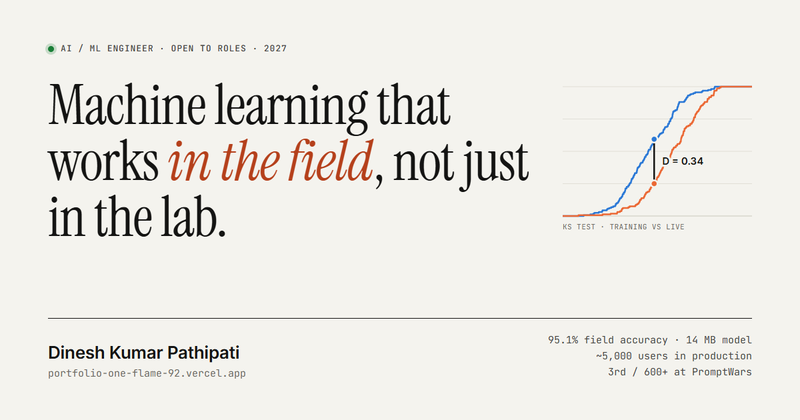

# Dinesh Kumar Pathipati — AI / ML Engineer

**Live:** https://portfolio-one-flame-92.vercel.app



One hand-written page, with no framework and no build step:

- **Four case studies**, each with an architecture diagram, results and the decisions behind them:
  crop-disease detection (published; 95.1% accuracy on field images with a 14 MB model),
  Reel Intelligence (LLM agent, 3rd of 600+ at PromptWars), RGMCET Eduflow (serverless AWS, ~5,000 users),
  and an MLOps drift-attribution platform (in progress, Phase 1 of 4 shipped).
- **An interactive drift lab**: a two-sample Kolmogorov–Smirnov test that runs in the browser.
  Shift the live data and watch the statistic and p-value respond.
- Light and dark themes, a keyboard-accessible chart with a table view, and reduced-motion support.

## Files

| File | Purpose |
|---|---|
| `index.html` | The whole site: markup, styles and scripts |
| `Dinesh_Kumar_Resume.pdf` | Résumé behind the download links |
| `og.png` | 1200×630 link preview for LinkedIn, Slack, X |
| `apple-touch-icon.png` | Home-screen icon |
| `dinesh_profile.jpeg` | Portrait |

## Run locally

```bash
python -m http.server 8000
```

## Deploy

```bash
vercel --prod
```
